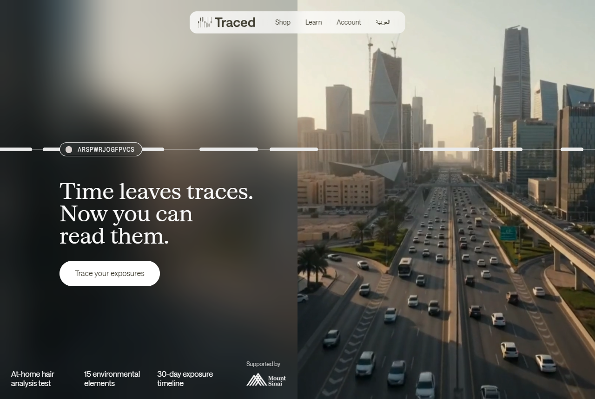
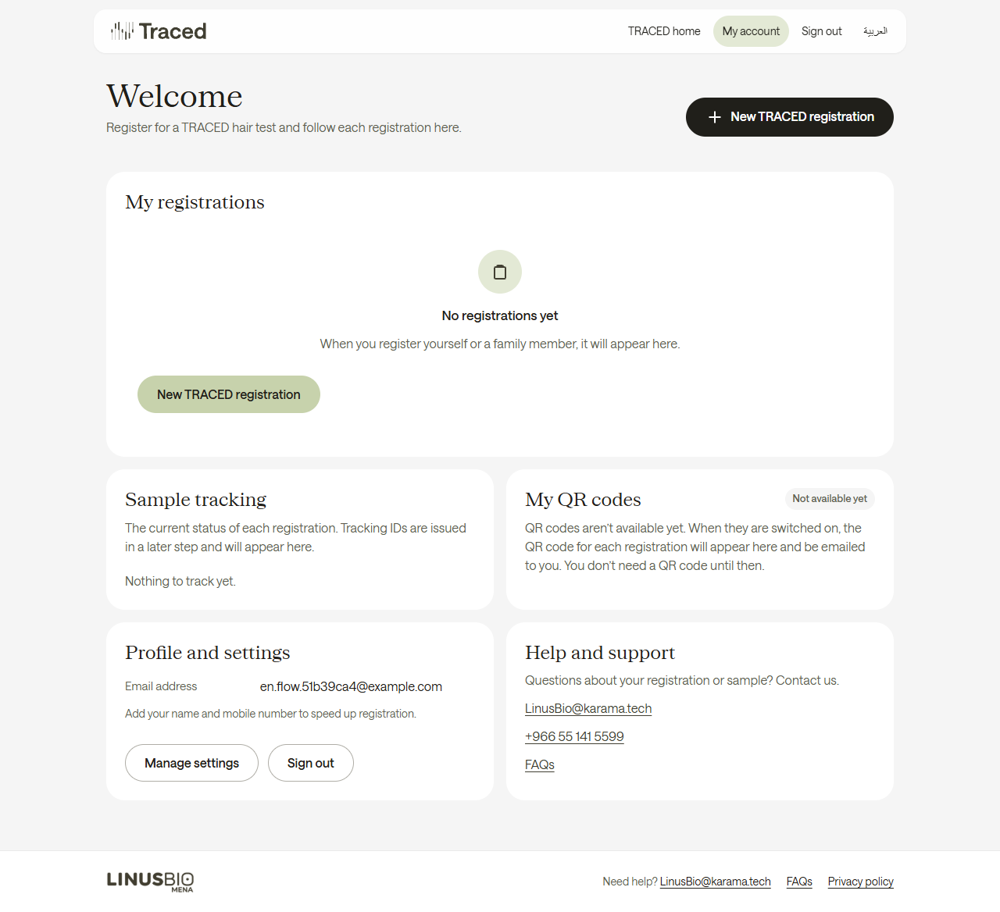
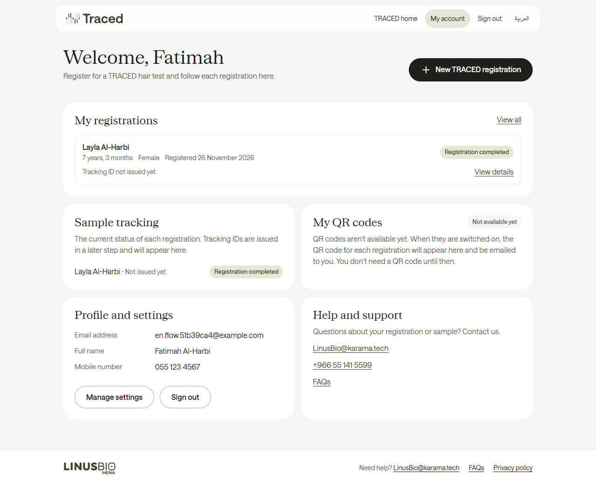
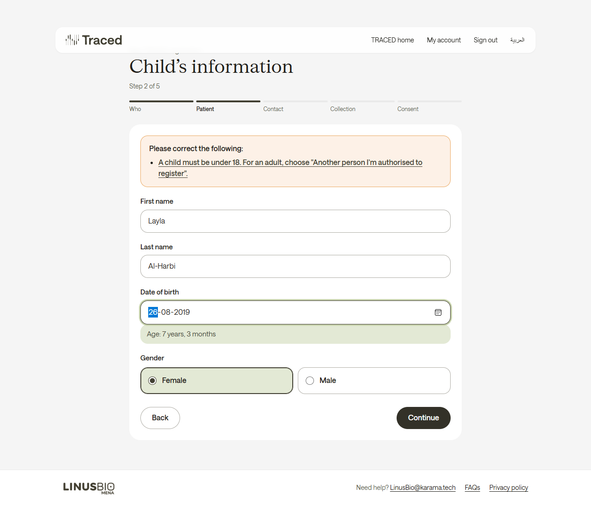
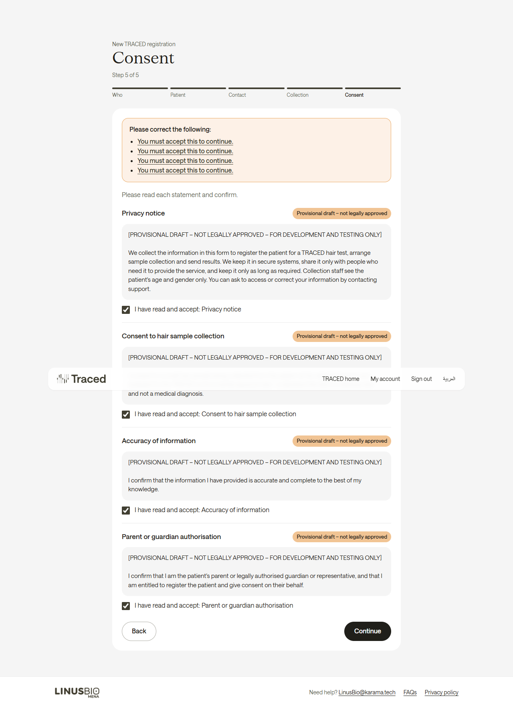
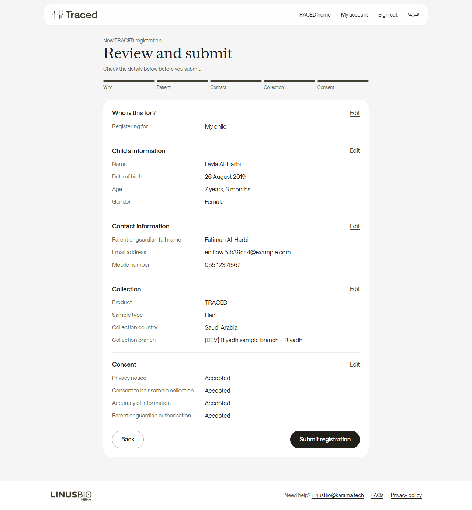
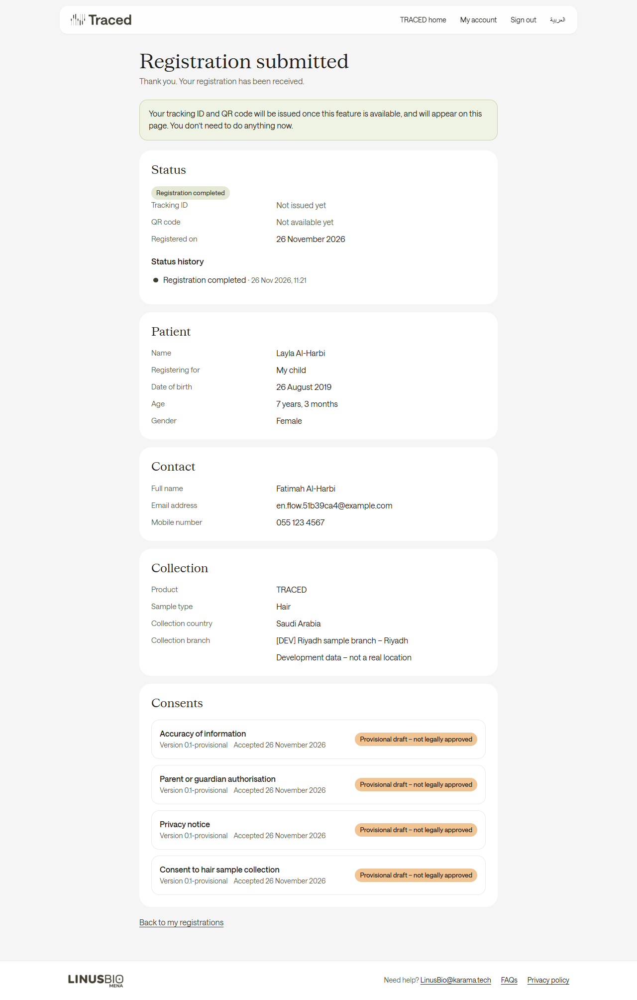
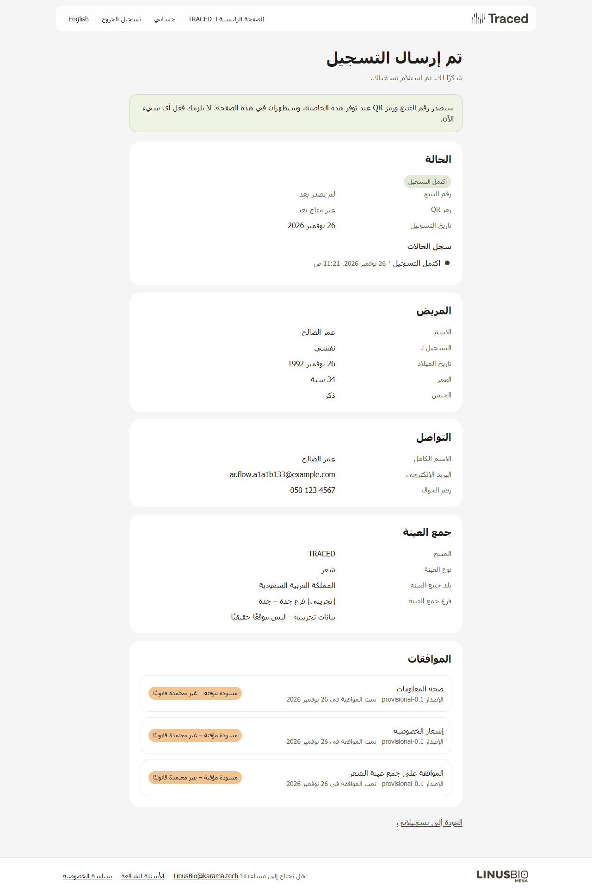
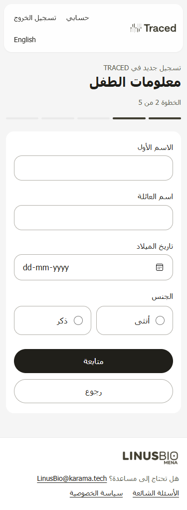

# TRACED Platform: Phase 2 Report

Customer portal and registration system · 26 November 2026 · branch `feature/traced-portal`. **Nothing committed, pushed, merged or deployed.** Everything ran locally against throwaway local databases.

## 1. Phase 1 verification (done before Phase 2 work)

| Check | Result | Evidence |
|---|---|---|
| 53 Phase 1 tests | **Pass**, 53/53 before any change; all still pass after Phase 2 | `npm test` |
| TypeScript typecheck | **Clean** | `npm run typecheck` |
| Role/permission matrix | Reviewed: 6 roles, 20 permissions, unchanged. Customers: `registration.create_own`, `registration.read_own` only. Collection staff: scan/collect/branch custody only, **no `registration.*` permission**. Only super admin has `report.export_pii`. A test asserts no staff/customer/lab/auditor role holds `registration.read_full` or `report.export_pii`. | `unit.test.ts`, `database.test.ts` |
| Collection staff cannot reach customer personal data through **any** endpoint | **Pass.** New test signs in as collection staff, creates a real customer registration with distinctive "canary" values (names, email, phone, DOB, user id), then calls **every registered API route** (all 22) and asserts no response contains any canary and every non-self-service route is refused. | `privacy-verification.test.ts` |
| Invitation tokens single-use, securely stored, expiring | **Pass.** Stored only as a 32-byte HMAC-SHA256 (never the token); 72 h expiry enforced; 5 simultaneous uses → exactly 1 succeeds; an invitation token can't be used as a reset or verification token. | `privacy-verification.test.ts` |
| Audit-log chain vs privileged DB users | Reviewed. See §1.1 for what it does and does not guarantee. | `database.test.ts` |

### 1.1 Audit log: actual guarantees and limitations

**What it guarantees today**
- Normal application code, and any database user subject to triggers, **cannot UPDATE, DELETE or TRUNCATE** audit rows (triggers reject it; tested).
- Each row's SHA-256 hash covers its content and the previous row's hash, with a gap-free `chain_seq`. `audit_verify_chain()` reports the first broken link. **Editing, deleting or reordering any row is detected**, even by a superuser who disables the triggers, *unless they also recompute the chain* (tested).
- Writers are serialised, so concurrent inserts can't fork the chain (tested with 40 concurrent writers).

**What it does not guarantee**
- **A privileged database user (owner or superuser) can rewrite the entire chain undetectably.** The hash uses no secret, and all inputs are in the same database, so someone with that access can disable the triggers, edit rows, recompute every hash from the edit onwards and re-enable the triggers. `audit_verify_chain()` would then report the chain as valid. The chain makes tampering detectable *by anyone who doesn't control the database*; it does not stop the database's own administrators.
- It doesn't prove that events were *recorded* (an attacker controlling the app could skip writing them), and it doesn't protect against deleting the whole table and its backups together.

**Recommended before production (not built; needs hosting decision)**
1. **External anchoring:** periodically (e.g. hourly) copy the latest `chain_seq` + `hash` to storage the DB admins can't alter, such as object storage with WORM/Object Lock, a separate account, or a signed daily digest emailed to compliance. A later rewrite then no longer matches the anchors.
2. **Separate DB roles:** the application connects as a non-owner role with only INSERT/SELECT on `audit_logs`; schema-owner credentials are kept offline.
3. Optionally, a keyed hash (HMAC) with the key held outside the database (KMS), so a DB-only attacker cannot recompute valid hashes.
4. Ship audit events to a separate log store (SIEM) as a second copy.

## 2. Completed features

**Customer portal (English + Arabic, desktop/tablet/mobile)**
- Pages: sign up, sign in, email verification (from the link, with resend), forgot password, reset password, account settings (profile, preferred language, change password), sign out, dashboard, new registration (multi-step), my registrations, registration details/confirmation.
- Form validation with an error summary that links to each field, `aria-invalid`/`aria-describedby` wiring, loading states (`aria-busy`), success/error messages in live regions, password show/hide toggle (`aria-pressed`), skip link, keyboard-only use, and focus moved to the heading on each step.
- Session handling: HttpOnly cookie only; CSRF token kept in memory (never in storage); redirects for signed-in and signed-out users; `next` is restricted to portal paths (no open redirect); emailed tokens are removed from the address bar immediately on load.
- Arabic: separate `/ar/...` pages (same pattern as the public site), RTL layout, Arabic validation messages, Arabic plural rules for ages, Gregorian dates, Arabic-Indic digits accepted in phone numbers, same Tahoma fallback font as the public site.
- **Honest Phase 3 placeholders:** "Tracking ID: Not issued yet", "QR code: Not available yet", and a dashboard QR card explaining that QR codes aren't switched on. No fictional QR or tracking ID is displayed.

**Dashboard:** welcome by name, "New TRACED registration", my registrations (latest 3 + view all), sample tracking (status per registration), my QR codes (not available yet), profile and settings, help and support (email, phone, FAQs), sign out, and empty states.

**Registration form, 5 steps + review:**
1. Who: myself / my child / another person I'm legally authorised to register.
2. Patient: first name, last name, date of birth (no future dates; live age in years + months), gender (female/male). **No National ID, Iqama or nationality.**
3. Contact: account holder's full name (labelled "Parent or guardian" for dependents, with a guardian notice), verified email prefilled read-only, Saudi mobile validation, optional "save to my profile".
4. Collection: TRACED / Hair / Saudi Arabia fixed; branch chosen from the database.
5. Consent: privacy notice, sample-collection consent, accuracy declaration, plus guardian authorisation for child/dependent. Each document is shown in full with a "Provisional draft – not legally approved" badge. Then a review screen with "Edit" per section, and submit.

**Backend**
- Migration `0004_registrations.sql` (additive): `collection_branches`, `patients` (separate from the account holder), `registrations`, append-only `registration_status_history`, versioned immutable `consent_documents`, append-only `consent_records`, plus nullable `users.full_name` / `users.phone`.
- Ownership enforced in SQL (every query scoped by `account_user_id`); someone else's registration id returns the same 404 as a missing one.
- Duplicate protection: required `Idempotency-Key` + per-key advisory lock + `UNIQUE (account_user_id, idempotency_key)` + request fingerprint (same key with different details → 409). 10 simultaneous submits → 1 registration (tested). An identical child is reused as the same patient record.
- **Tracking ID ready for Phase 3 without migration:** `tracking_id` with a DB CHECK for exactly `TRC-SA-MM/YY-XXXXX`, `tracking_period` (YYMM) + `tracking_seq` (1–99999) with `UNIQUE(period, seq)`, all NULL together until Phase 3. No temporary format is stored or shown.
- Full 13-status list defined once in the schema; Phase 2 only creates `registration_completed`.
- Consent: current version per type/locale served by the API; submitting an outdated version → 409 `CONSENT_OUTDATED` and the form reloads the new text. Published text is immutable (new wording = new version). **Production refuses provisional documents** (only `approved` allowed when `NODE_ENV=production`).
- Audit entries: `registration.created`, `patient.created`, `patient.updated` (field names only), `account.profile_updated`. No names, phones or emails in audit rows (tested).
- **Navigation entry on the existing site:** an "Account" / "الحساب" item in the TRACED header (all 56 EN/AR pages), styled with the site's own classes, shown as a person icon on phones. The footer "Account" link, which went to the original company's US Shopify accounts (`account.traced.life`), now goes to `/traced/account/`.

## 3. Files

**Created**
- Migration: `server/migrations/0004_registrations.sql`
- Server: `server/src/server.ts`; `server/src/modules/registrations/{rules,registrations.service,registrations.repo,me.routes}.ts`; `server/src/modules/consents/{consents.service,provisional-content}.ts`; `server/src/modules/dev/seed.ts`; `server/src/cli/seed-dev.ts`
- Portal (static, served from `dist/`): `dist/portal/css/portal.css`; `dist/portal/js/main.js`; `dist/portal/js/core/{api,app,dom,i18n,paths,rules,ui}.js`; `dist/portal/js/i18n/{en,ar}.js`; `dist/portal/js/pages/{common,dashboard,forgot-password,register,registration,registrations,reset-password,settings,sign-in,sign-up,verify-email}.js`; 20 generated pages under `dist/traced/account/**` and `dist/ar/traced/account/**`; `dist/traced-account-nav.css`
- Scripts: `scripts/build-portal-pages.mjs` (generates the 20 page shells), `scripts/patch-traced-account-links.mjs` (idempotent nav/footer patch), `scripts/portal/traced-logo.svg`
- Tests: `server/test/{registrations,privacy-verification,frontend}.test.ts`; `server/test/e2e/{serve,helpers}.ts`, `server/test/e2e/portal.spec.ts`; `playwright.config.ts`
- Docs: `docs/phase-2-report.md`, `docs/phase-2/screenshots/*.png` (24)

**Modified**
- Existing site: **56 TRACED pages** (28 EN + 28 AR). Each gets exactly three changes: a `<link>` to `traced-account-nav.css` after the existing `language-switch.css` link, the header nav item, and the footer link target. No other page content, images, videos, animations or scripts changed (verified with `git diff`). `language-switch.js`, the site CSS and every other shared file are untouched.
- Phase 1 files (uncommitted, small, additive): `server/src/app.ts` (mount `/me` routes), `server/src/index.ts` (uses `createHttpApp`), `server/src/db/migrate.ts` (refuses non-UTF-8 databases), `server/src/db/embedded.ts` + `server/src/cli/dev-db.ts` (initialise local DBs as UTF-8), `server/test/helpers/{global-setup,test-app}.ts` (UTF-8 + dev seed).
- `package.json` (scripts `seed:dev`, `build:portal`, `check:portal`, `test:e2e`; dev dependency `@playwright/test@1.65.0`), `package-lock.json`, `docs/development.md`.

## 4. Database migrations

`0004_registrations.sql`, additive only, backward-compatible: new tables listed in §2, two nullable columns on `users`, triggers for append-only/immutability, indexes, and constraints (one "myself" patient per account; tracking-ID format; per-account idempotency key; consent uniqueness). Phase 1 tables and data are unaffected. Applied to throwaway test/E2E databases only.

## 5. API endpoints added (`/api/v1`)

| Method & path | Access | Purpose |
|---|---|---|
| `GET /me/profile` | signed in | own email, name, mobile, language |
| `PATCH /me/profile` | signed in | update name / mobile / language (audited) |
| `GET /me/registration-form?locale=` | verified customer | active branches, current consent texts, profile prefill, date rules |
| `POST /me/registrations` | verified customer + `Idempotency-Key` | create registration (201, or 200 on replay) |
| `GET /me/registrations` | verified customer | own registrations (summary allowlist) |
| `GET /me/registrations/:id` | verified customer, owner only | details, consents, status history; QR `{available:false}` |

## 6. Frontend routes (English; Arabic identical under `/ar`)

`/traced/account/` (dashboard) · `/traced/account/sign-in/` · `/sign-up/` · `/verify-email/` · `/forgot-password/` · `/reset-password/` · `/settings/` · `/register/` · `/registrations/` · `/registration/?id=<uuid>`. Entry from the TRACED header "Account" item and the footer "Account" link.

## 7. Test results

| Suite | Result |
|---|---|
| TypeScript typecheck | **clean** |
| Unit + integration (Vitest, real PostgreSQL 18) | **86 / 86 pass**: Phase 1: 53 (unit 12, database 7, auth 22, RBAC/MFA 12); Phase 2: 33 (registrations 22, privacy verification 5, frontend 6) |
| Browser end-to-end (Playwright on Microsoft Edge) | **9 / 9 pass** (≈ 55 s) |
| Generated pages / nav patch up to date | pass (`npm run check:portal`) |
| `npm audit` | 0 vulnerabilities |

Coverage of your requested areas:

| Area | Where |
|---|---|
| Sign-up / sign-in integration, email verification | Phase 1 suites + E2E EN/AR flows (real emailed links) |
| Registration form validation | API: 14 invalid cases incl. future DOB, adult as "child", minor as "myself", non-Saudi mobile, HTML in names, extra fields such as `nationalId`/`trackingId`/`status`. Browser: error summaries, field errors |
| Patient age calculation | unit tests (incl. 29 Feb, newborn, future) and browser live age "7 years, 3 months" |
| Child and guardian registrations | API + E2E (guardian consent present for child/dependent, absent for myself) |
| Consent recording | API: records per document, outdated version refused, texts/records immutable |
| Ownership / unauthorised access | API + E2E: other customer's id → identical 404 |
| Collection staff PII restriction | all-routes canary sweep + 403 on every customer endpoint |
| Duplicate submission | API: same-key retry, 10 concurrent, key reuse with different details. E2E: double-click → 1 registration |
| Arabic and English interface | E2E AR flow (RTL, Arabic messages, Arabic names, Arabic-Indic digits, language switch keeps the page); dictionary parity test |
| Mobile responsiveness | E2E at 375 px on every portal page (EN/AR); TRACED header checked at 360/375/390/768 px, EN and AR |

Defects found by testing and fixed during Phase 2:
1. **Local databases on Windows used the WIN1252 encoding and could not store Arabic.** All dev/test databases are now UTF-8, and migrations refuse to run on any non-UTF-8 database.
2. The new header item pushed the language switch out of the header bar on phones. Fixed with the icon on phones plus a slight padding trim at ≤400 px. The header now fits exactly like the original at 360/375/390/768 px.
3. Opening a second emailed link while already on the verify page did nothing (hash-only change). It now reloads.
4. Emailed tokens stayed in the address bar until the session check finished. They are now removed immediately.
5. Layout fixes: step progress bars were invisible, dashboard cards were misaligned, mobile buttons didn't fill the width, the focus box showed on headings, and email/phone alignment was wrong in Arabic.
6. Retrying after editing a failed submission would have been refused as a reused key. The form now issues a new key when the details change.

## 8. Screenshots (`docs/phase-2/screenshots/`)

| | | |
|---|---|---|
|  TRACED header, new "Account" item |  Dashboard, empty state |  Dashboard with a registration |
|  Step 2, validation + live age |  Step 5, provisional consents |  Review |
|  Confirmation (honest Phase 3 note) |  Arabic confirmation (RTL) |  Mobile, Arabic step 2 |

All 24: sign-up validation (EN/AR), check-email, dashboards (EN/AR, empty/filled, mobile), each registration step, review, confirmations, my registrations, password reset, settings, TRACED header (EN/AR/mobile).

## 9. Security verification

- **Backend-enforced privacy model:** customers see only their own data (SQL-scoped, 404 for others); collection staff have no route to registration data (all-routes sweep); admins have no registration API yet (Phase 5).
- **No personal data in URLs** (only the registration UUID), **logs** (logger receives ids only; no PII logged by new code), **browser console** (test enforces no `console.*` in portal code), **analytics** (portal pages load no third-party scripts; CSP `default-src 'self'`; test enforces no external URLs), **error messages** (fixed generic messages per code), or **audit metadata** (tested).
- **XSS:** the portal never builds HTML from strings (test enforces no `innerHTML`/`eval`); strict CSP without `unsafe-inline`; names restricted to letters.
- **CSRF / sessions:** unchanged Phase 1 protections; portal sends the in-memory token on every write; no tokens in storage (test enforces `localStorage` only for the language preference).
- **Input validation:** strict schemas reject unknown fields (e.g. `nationalId`, `trackingId`, `status` cannot be injected).
- **Not done yet (Phase 7):** OWASP ZAP scan, load test, independent penetration test, screen-reader testing with NVDA/VoiceOver (keyboard and ARIA checks only so far).

## 10. Known issues and blockers

1. **No real email provider** (Phase 3). Emails are written to a local folder; production start is blocked by design.
2. **Consent texts are provisional placeholders** written by the dev team and must be replaced by approved legal texts (EN + AR). Production refuses provisional texts.
3. **Arabic interface and email copy are machine/developer-drafted** and need professional linguistic review.
4. **Collection branches:** only clearly marked `[DEV]` sample branches exist in dev databases. Real branches will be created in the admin portal (Phase 5), or I can add a CLI earlier if you need it.
5. **Portal JS sub-modules aren't individually cache-busted**; only `main.js` and the CSS carry `?v=`. Before production, set short cache headers (or content hashes) for `/portal/js/*`.
6. The browser logs a "401" console line on signed-out portal pages (the normal "am I signed in?" check). Harmless, but it can look like an error in devtools.
7. The public site's existing pages still load Shopify/Okendo scripts from the original store; this was already the case and is out of Phase 2 scope.
8. Hosting region, data residency and the cross-border US lab question remain open (see Phase 0).

## 11. Decisions requiring your approval

1. **Gender options:** currently *Female / Male* only. Confirm, or specify others.
2. **Age rules:** "Myself" requires 18+; "My child" requires under 18; "Authorised person" accepts any age. Confirm 18 as the threshold.
3. **"Myself" patient updates:** if a customer registers "myself" again with corrected details, the single "myself" record is updated (audited by field name). Alternative: keep a per-registration snapshot of patient details.
4. **Contact email** is always the verified account email (not editable in the form). Confirm.
5. **Header entry label:** "Account" / "الحساب" (matches the existing footer wording), person icon on phones. Alternatives: "Sign in" / "My account".
6. **Repointing the footer "Account" link** away from `account.traced.life` (done locally, not deployed). Confirm.
7. **Consent documents:** who approves the final texts, and their version numbers.
8. Approval to **commit and push** Phase 1 + Phase 2 to `feature/traced-portal`, and to start **Phase 3** (tracking IDs, QR engine, email), which needs the email provider and sending-domain decision.

## 12. Completion

- **Phase 2: complete for its scope**, verified by 86 automated tests, 9 browser end-to-end tests and 24 screenshots. Admin access to registrations is intentionally deferred to Phase 5.
- **Overall: about 30%** by Phase 0 hour estimates (Phases 0–2 ≈ 100 of ≈ 300–390 h).
