# TRACED Platform: Phase 4 Report

Collection staff portal and QR scanning · 26 November 2026 · branch `feature/traced-portal` · developed and tested locally; **not deployed, nothing provisioned or purchased**.

## 1. Executive summary

Collection staff can now sign in to a dedicated bilingual portal, choose their assigned branch, and scan a customer's QR with the device camera or a USB scanner. They see **only the patient's age and gender** plus operational data. They then record identity verification through a pluggable framework, complete a versioned checklist and confirm collection. Confirmation is a single database transaction that re-checks everything and makes duplicate collection impossible, even with simultaneous requests from several devices. The customer's page updates to "Sample collected", and their QR stops working.

QR revocation now follows your permission rules (customer for their own registration; admin/super admin with a mandatory reason; never staff, lab or auditors) and is safe against concurrent collection. The approved GCP architecture is documented, including how email retries keep working when Cloud Run scales to zero (scheduled endpoint built and tested).

Verified: **154/154** unit/integration tests (25 new), **16/16** browser tests (7 new, using a simulated camera that feeds a real QR into the actual scanner path), clean typecheck, 0 npm vulnerabilities.

Two findings need your attention:
1. **The GitHub repository is public.**
2. **Production collection is intentionally impossible until an approved identity-verification method exists.**

## 2. Baseline and Git safety

- **Phase 3 baseline before starting:** clean tree at `66d4b00`; typecheck clean; **129/129** tests pass; 9/9 browser tests had passed at the end of Phase 3.
- **Deployment check:** the GitHub API shows **0 deployments** for the repository and **no commit statuses or check runs** on the pushed commits (`cdcb44d`, `66d4b00`). A Vercel/Netlify/CI integration would create these. The repository contains no `vercel.json`, `.vercel/`, Netlify or workflow files. **Conclusion: pushing `feature/traced-portal` triggers no deployment.** Limitation: webhook settings themselves need repository-admin access to view; nothing suggests any exist.
- ⚠️ **The repository `linusbiomena-commits/Traced.Life` is public** (`"private": false`). No secrets or patient data are in it, but source code, security design and plans are world-readable. **Recommendation: make it private** (GitHub → Settings → General → Danger Zone → Change visibility).

## 3. Completed features

**Staff authentication and access**
- Staff sign-in page; invitation acceptance (`/traced/staff/accept-invite/`, plus `/traced/admin/accept-invite/` for admin invitations); password reset through the existing flow; sign-out returns to staff sign-in. No self-registration.
- The CLI now creates staff with a name and branches: `npm run create-user -- --email … --role collection_staff --name "…" --branch DEV-RUH-01`.
- Staff signing in on the customer page are routed to the staff portal; customers opening staff pages see "No access" and no staff API works for them (403).
- Active-status, permission and branch checks on every staff request (and again inside the collection transaction).

**Staff dashboard:** name, branch (selector when assigned to several), today's figures from the API (collected at branch, collected by me, awaiting at branch; Asia/Riyadh day), Scan button, recent collections, links to history and settings, sign-out.

**Camera scanner**
- Library evaluation: `html5-qrcode` 2.3.8 was last released in April 2023 (unmaintained), so it was rejected. **`@zxing/browser` 0.2.1 (MIT, July 2026)** is maintained, self-contained and CSP-compatible (no `eval`), so it was chosen and is vendored on our own origin. The browser's native `BarcodeDetector` is used first where it supports QR.
- Rear camera preferred, camera switching when several are available, explicit start (works with iOS user-gesture rules), `playsinline`.
- Frames are decoded on the device and never uploaded. The camera stops on a successful read, on Stop, on page hide and on navigation. One result per start, and a busy guard prevents repeated requests for the same QR.
- **Manual / USB keyboard-wedge input.** Content is checked before any request: only a TRACED customer token is sent. A tracking ID alone is rejected. URLs in QR codes are never opened. Raw QR content is never logged or shown.
- Clear messages for: not recognised, revoked, **replaced**, cancelled, already collected, wrong/unassigned branch, camera permission denied, no camera, insecure context, network/server errors.

**Scan result and privacy:** tracking ID, patient age, patient gender, sample type (hair), status, authorised branch, instructions, identity-verification status. Built by one allowlist function on the server.

**Identity-verification framework** (`docs/identity-verification.md`)
- States: Not verified / Pending / Verified / Failed. Each change is an append-only event bound to patient + registration + collection session, recording method, time, outcome and staff account.
- A scan never verifies identity. A correction to the patient's details invalidates an earlier verification.
- **Development-only simulation**, clearly labelled, available only with `DEV_IDENTITY_VERIFICATION=true`. The configuration **refuses** this in production, the endpoint returns 404 when it's off, and the confirmation transaction rejects the dev method in production.
- Proposed production methods (customer-device OTP, Nafath, supervised document check), including child/guardian and dependent scenarios, are documented for approval.

**Collection instructions:** versioned and immutable (`collection_instructions`, EN/AR, provisional/approved). Development text is labelled *"PROVISIONAL – NOT APPROVED"* and contains **no clinical procedure**. Production refuses provisional versions. The version used is stored with each collection. Ready for Phase 5 admin management.

**Collection confirmation (single transaction):** lock order registration → patient → session/token → audit. Re-checks session owner and expiry, staff still active with `collection.collect`, branch assignment (row share-locked), registration still awaiting, no live sample, QR token still the active one, identity verified for this session and unchanged patient, and the complete checklist of the current instructions. It then writes the `samples` row, status history (`awaiting_sample_collection → sample_collected`, staff, role), marks the QR **used**, closes the session and appends an audit event. The `samples_one_live_per_registration` unique index makes a second sample impossible at database level.

**Customer view after collection:** status "Sample collected", the date and branch of collection, "This QR code was used… and is no longer valid", tracking ID and history still visible, and QR images/replacement disabled. The page refreshes itself every 20 s while awaiting collection.

**QR lifecycle and permissions**
- Active → revoked or used (both terminal; enforced by trigger).
- No automatic expiry.
- Customer replacement: own registration, before collection, 3/day.
- **Admin revocation API** `POST /admin/registrations/:id/qr/revoke`: `qr.revoke` + MFA, **reason mandatory (5–200 characters)**, optional regenerate (default yes) and customer notification. Records who and when, plus an audit event. The admin UI follows in Phase 5.
- Staff, lab operators and auditors are refused (tested).
- Replacement and collection both lock the registration row first, so the final state is always consistent (tested under simultaneous requests).

**Collection history:** tracking ID, age (on collection day), gender, sample type, status, time, branch, "by you". Filters: date range (Riyadh days), assigned branch, status, exact tracking ID. Read-only; there is no edit or reversal path for staff.

**Cloud Run support:** `POST /api/v1/internal/outbox/run` for Cloud Scheduler (shared secret, constant-time comparison, 404 when unconfigured); `DB_POOL_MAX` for connection pooling.

## 4. Remaining (by design, later phases or approval)
Admin dashboard and staff/branch/instruction management UI (Phase 5); physical sample labels and chain of custody (Phase 6, schema ready: `samples.sample_code`, sample statuses); approved identity method; approved instructions; Nafath/SMS; provisioning and deployment.

## 5. Files

**Created**
- Migration: `server/migrations/0007_collection.sql`
- Server: `server/src/modules/collection/{collection.service,instructions}.ts`; `server/src/modules/qr/{lifecycle,admin-qr.routes}.ts`; `server/src/modules/mail/internal.routes.ts`
- Portal: `dist/portal/js/core/scanner.js`; `dist/portal/js/pages/{staff-common,staff-sign-in,staff-dashboard,staff-scan,staff-history,staff-settings,accept-invite}.js`; `dist/portal/vendor/zxing-browser.min.js` (+ `LICENSE`); 14 generated pages under `dist/traced/{staff,admin}/**` and `dist/ar/traced/{staff,admin}/**`
- Tests: `server/test/staff.test.ts`; `server/test/e2e/{staff.spec,fake-camera}.ts`
- Docs: `docs/architecture.md`, `docs/identity-verification.md`, `docs/device-testing.md`, `docs/phase-4-report.md`, `docs/phase-4/screenshots/` (16 staff + 27 customer)

**Modified**
- Server: `app.ts` (routes), `config.ts` (dev-verification flag refused in production, pool size, cron secret), `index.ts` (pool size), `cli/create-user.ts` (`--name`, `--branch`), `modules/dev/seed.ts` (provisional instructions), `modules/qr/staff.routes.ts` (staff API), `modules/qr/qr.service.ts` (old reissue helper removed), `modules/registrations/{me.routes,registrations.repo}.ts` (shared replacement path; QR only before collection; collection info)
- **Removed:** `server/src/modules/qr/validation.service.ts` (superseded by the collection service)
- Portal: `core/{app,paths}.js` (staff routing/navigation), `main.js`, `i18n/{en,ar}.js` (+112 keys each), `pages/{sign-in,dashboard,registration}.js`, `css/portal.css`; 22 existing portal shells regenerated (asset version bump)
- Scripts: `build-portal-pages.mjs` (staff pages, vendor copy and check), `patch-traced-account-links.mjs` (skips portal folders)
- Tests: `helpers/test-app.ts`, `e2e/{helpers,serve}.ts`, `frontend.test.ts`, `privacy-verification.test.ts`, `qr.test.ts` (Phase 3 expectations updated to the richer scan response and `REPLACED` reason)
- Config/docs: `package.json`, `package-lock.json` (dev dependency `@zxing/browser@0.2.1`), `playwright.config.ts` (simulated camera), `.env.example`, `docs/development.md`
- **Existing public TRACED pages modified: none.**

## 6. Database changes (migration 0007, additive)
- `customer_qr_tokens`: status adds `used` (+ `used_at`, consistency check); guard trigger makes revoked/used terminal.
- `collection_instructions` (versioned, immutable, no delete).
- `collection_sessions` (staff, branch, QR token, 30-minute expiry).
- `identity_verifications` (append-only events).
- `samples` (one live sample per registration via unique index; no delete; Phase 6 fields ready).
- Earlier migrations untouched; checksums intact; UTF-8 and Cloud SQL compatible.

## 7. API endpoints

| Endpoint | Access |
|---|---|
| `GET /staff/me` | `collection.scan` |
| `GET /staff/dashboard?branchId=` | `collection.scan` + assigned branch |
| `POST /staff/qr/validate` `{code, branchId}` (extended) | `collection.scan` + branch; 60/min, invalid scans 10 per 5 min |
| `GET /staff/collection-sessions/:id` | session owner |
| `POST /staff/collection-sessions/:id/identity/dev` | session owner, **development only** |
| `POST /staff/collection-sessions/:id/collect` | `collection.collect` + all transactional checks |
| `GET /staff/history` (filters) | `collection.scan`, assigned branches only |
| `POST /admin/registrations/:id/qr/revoke` | `qr.revoke` + MFA (admin, super admin) |
| `POST /internal/outbox/run` | Cloud Scheduler secret |

Changed: `/me/registrations/:id` adds `collection`; QR images and resend only before collection; `/me/registrations/:id/qr/regenerate` uses the shared, lock-safe replacement and works after an admin revocation without replacement.

## 8. Frontend routes (EN; Arabic under `/ar`)
`/traced/staff/` · `/traced/staff/sign-in/` · `/traced/staff/scan/` · `/traced/staff/history/` · `/traced/staff/settings/` · `/traced/staff/accept-invite/` · `/traced/admin/accept-invite/`

## 9. Roles and permissions
No new permissions were needed; the Phase 1 catalogue already matched your rules:
- `collection_staff` has `collection.scan`, `collection.collect` and `custody.record_branch`, and **no** `qr.revoke`.
- `qr.revoke` is held only by admin and super admin (MFA required). Lab operator and auditor have neither.

All of this is now exercised by tests, including revocation attempts by every refused role.

## 10. Screenshots (`docs/phase-4/screenshots/`)

| | | |
|---|---|---|
| 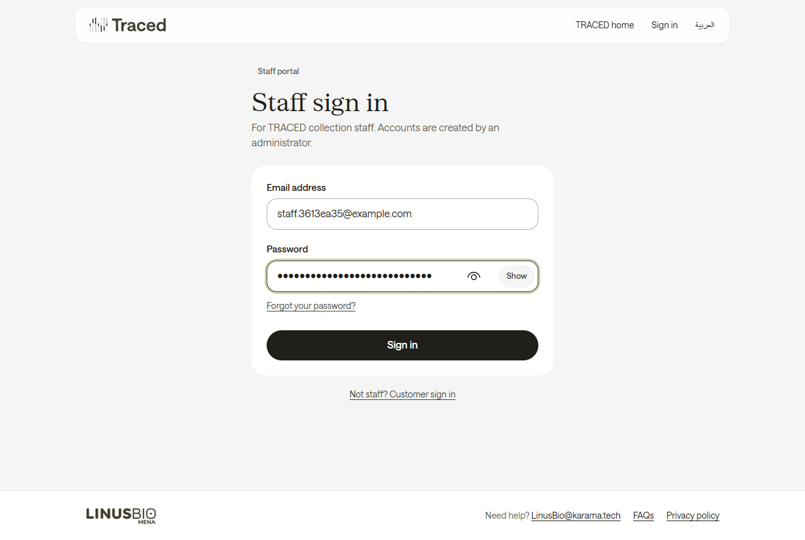 Staff sign-in | 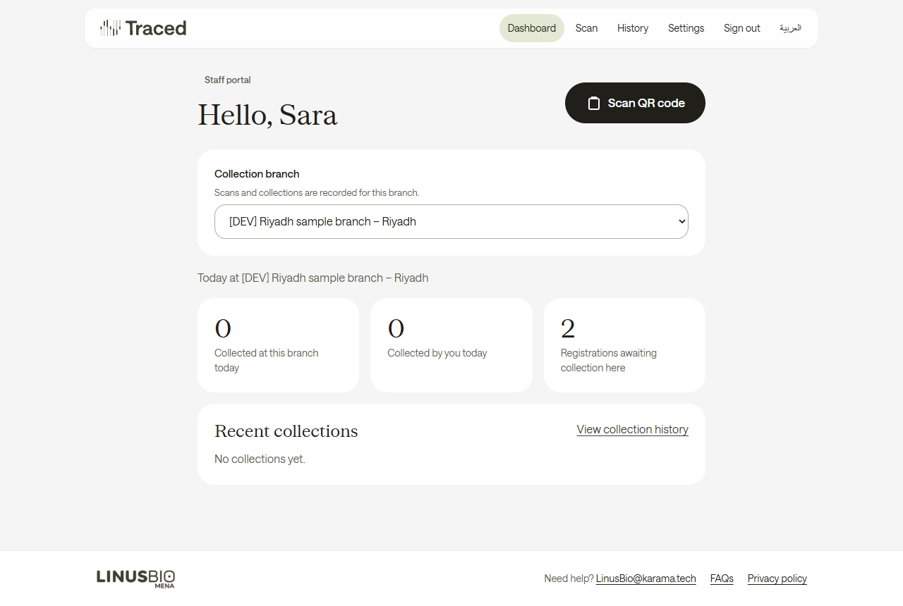 Dashboard (two branches) | 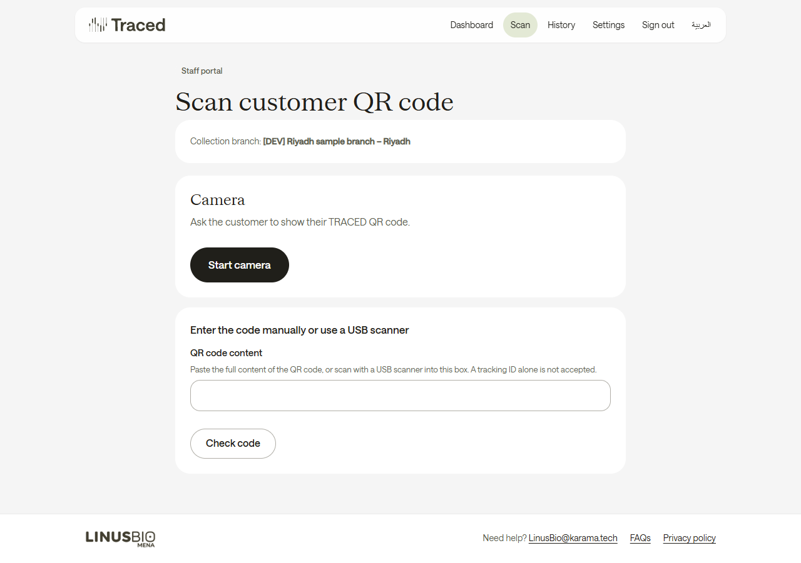 Scanner |
| 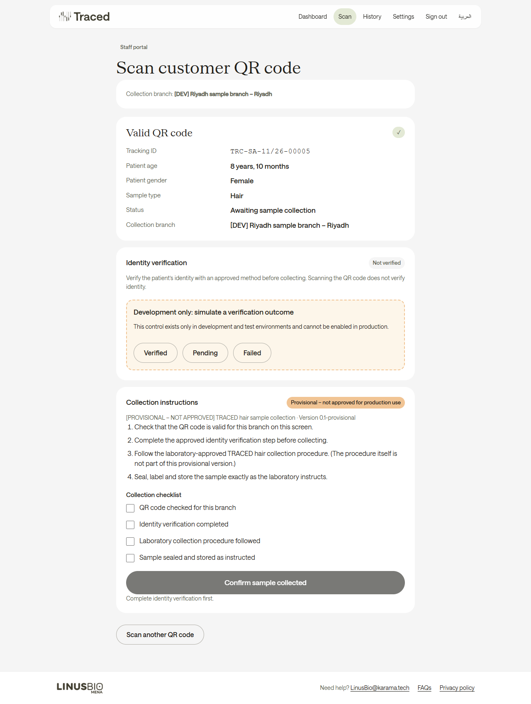 Valid scan: age/gender only | 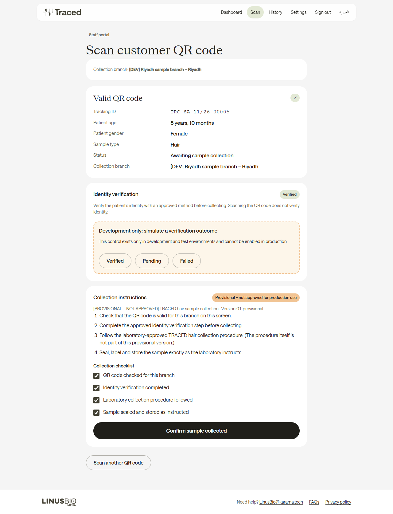 Verified + checklist | 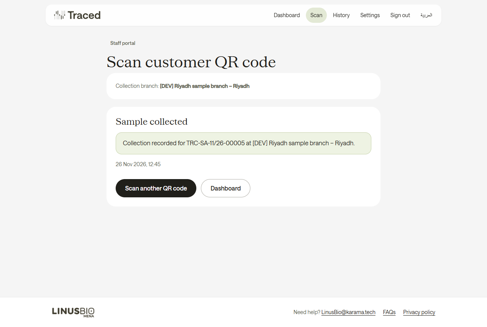 Collection confirmed |
| 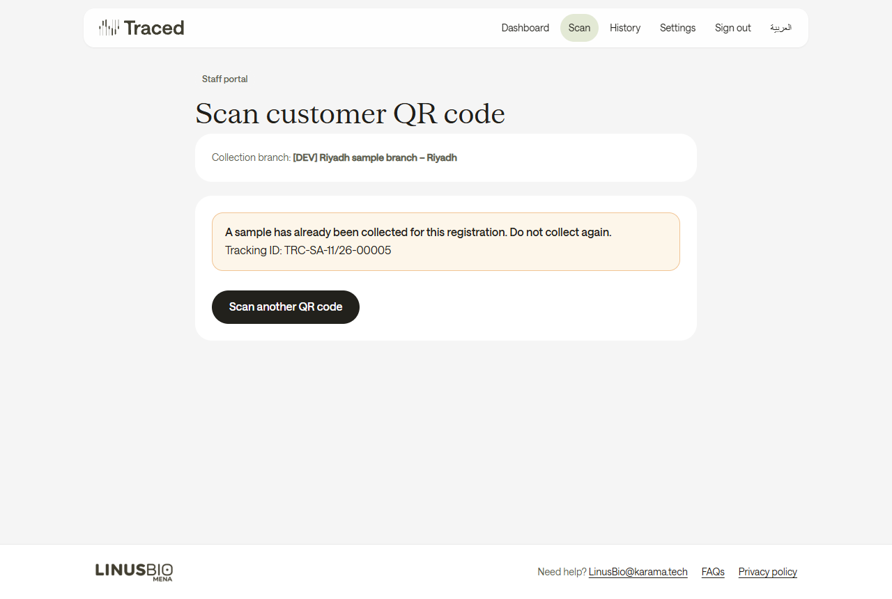 Already collected | 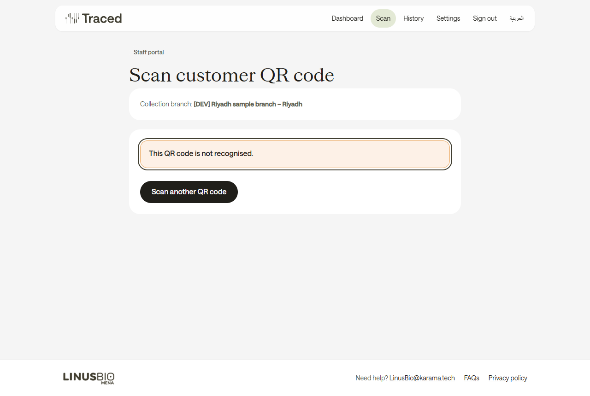 Invalid QR | 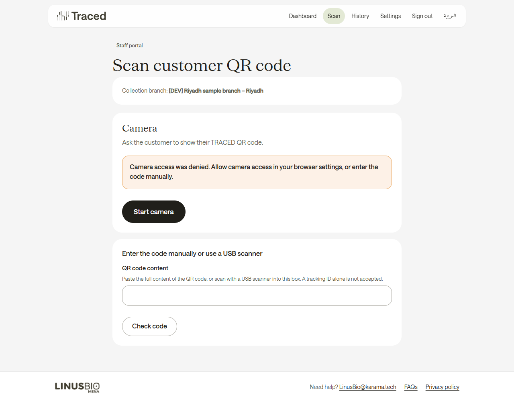 Camera denied |
| 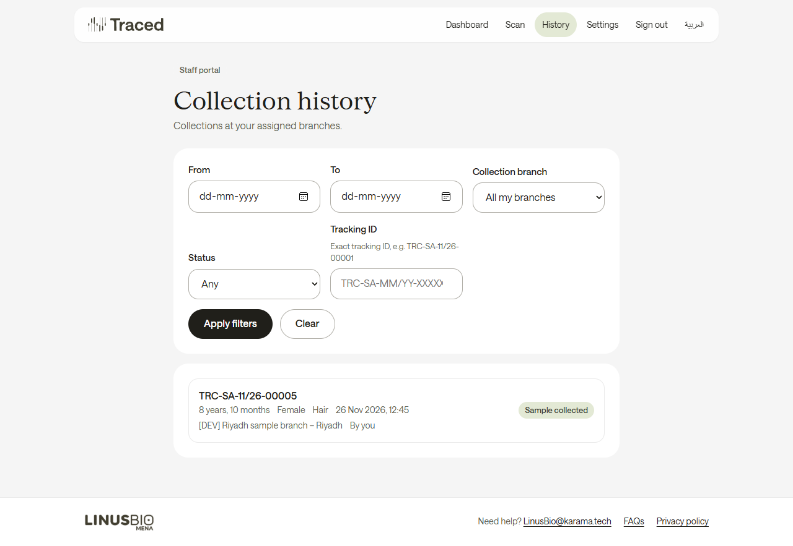 History | 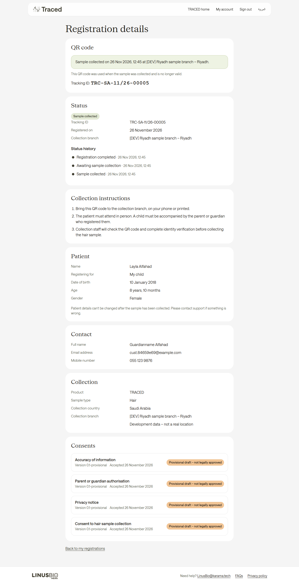 Customer after collection | 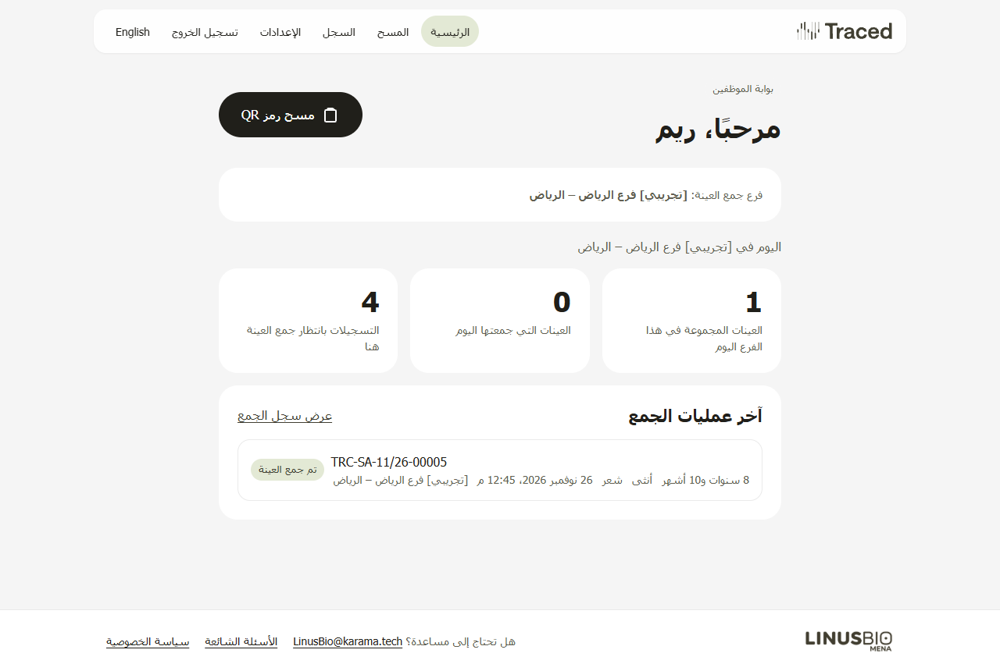 Arabic dashboard |
| 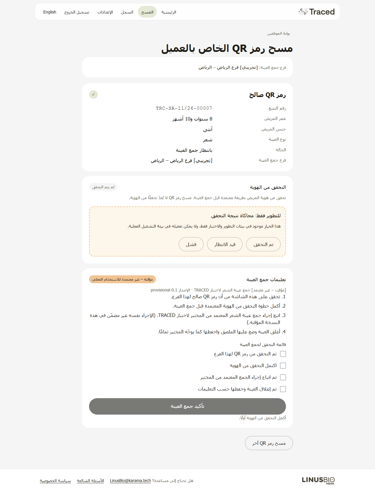 Arabic scan result | 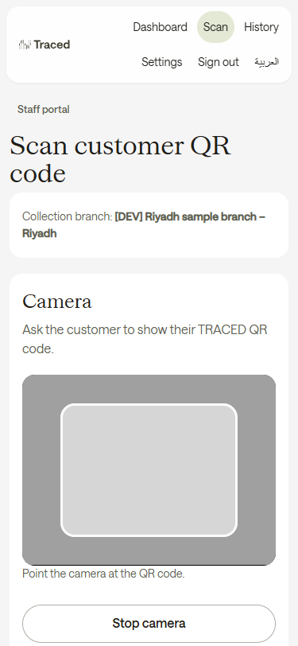 Mobile live scanner | 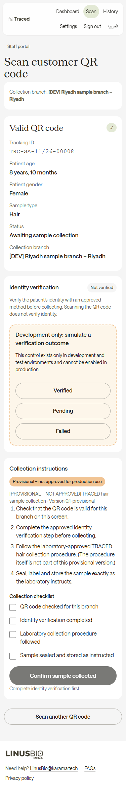 Mobile result |

Customer-portal regression screenshots: `docs/phase-4/screenshots/customer/` (27).

## 11. Test results

| Suite | Result |
|---|---|
| TypeScript typecheck | **clean** |
| Unit + integration (Vitest, real PostgreSQL 18) | **154 / 154 pass** (129 existing + **25 new** in `staff.test.ts`) |
| Browser E2E (Playwright, Microsoft Edge) | **16 / 16 pass** (9 customer + **7 new staff**), ≈ 1.5 min |
| Generated pages / vendor bundle / nav patch checks | pass |
| `npm audit` | 0 vulnerabilities |

New coverage by area:
- **Auth/authz:** invitation → setup → sign-in; customers, signed-out, lab and auditor refused; staff refused on admin endpoints; suspended staff cut off; branch enforcement; multiple branches.
- **QR outcomes:** valid; unknown; malformed; tracking-ID-only; revoked; replaced; cancelled; already collected; wrong branch; unassigned branch; session reuse on repeat scan; invalid-scan rate limit.
- **Permissions:** customer own vs other; admin with mandatory reason; super admin; staff/lab/auditor refused; old token dies; audit records who, when and why; revoke-only then customer regenerate.
- **Privacy:** exact allowlist keys for scan, history and collect; canary sweep (patient name, guardian name, email, phone, DOB, user/registration ids, raw token) across scan, session, dev, collect, error, history, dashboard and audit.
- **Identity:** all four states; collection blocked unless verified; scan doesn't verify; correction invalidates; dev endpoint 404 when off; production config refuses it.
- **Collection:** success with all records; checklist required; outdated instructions; other staff's session; customer refused; **8 simultaneous confirmations from two staff → exactly 1 sample**; QR replaced before and *during* confirmation (consistent end states); branch removal and suspension mid-collection; customer view updated.
- **Browser:** staff sign-in; dashboard; scanner; **simulated-camera scan**; camera released after read; invalid inputs incl. arbitrary URL QR (not opened); permission denied and no camera; confirmation; already collected; history; customer updated; routing/forbidden; Arabic RTL; mobile 375 px incl. live scanner; keyboard (Enter in manual field).

## 12. Security and privacy verification
- Authentication on all staff endpoints; permission, branch and object checks; customers refused; explicit allowlists; no-store responses (global API middleware); CSRF unchanged; rate limits on scans, invalid scans, collection and admin revocation.
- No raw QR token in logs, audit, outbox, JSON responses or screen (tests). The scanner never uploads frames and makes no external requests (CSP `default-src 'self'`; vendored library).
- Error responses checked for personal data (branch-refusal and verification errors included in the sweep).
- Audit events: `qr.validated` (success/failure/denied, with field names accessed), `identity.verification_recorded`, `sample.collected`, `sample.collect_refused`, `qr.regenerated`/`qr.revoked` (actor, role, reason), `staff.branch_denied`. The audit chain is **tamper-evident, not tamper-proof** (plan unchanged: restricted roles + external checkpoints, Phase 7).

## 13. Physical-device testing
**Not performed.** Only Edge on Windows with a simulated camera was tested automatically. The procedure and recording table for Android, iPhone, tablet, desktop webcam and USB scanner are in `docs/device-testing.md`. It needs HTTPS (staging or an approved tunnel). **No device compatibility is claimed.**

## 14. Issues discovered and resolved
1. **Identity verification never counted** (a JavaScript `Date` dropped PostgreSQL microseconds, so the "still current" check always failed): fixed by copying the timestamp inside SQL. Found by the new tests.
2. A potential deadlock and race between patient correction and collection: fixed by locking patient after registration in collection; covered by tests.
3. Sign-up IP rate limiting tripped across browser tests: the E2E stack now uses per-customer forwarded IPs (as behind Cloud Run's proxy); production limits unchanged.
4. Fake-camera file reuse in Edge within one page (test-only): handled in tests.
5. Duplicate heading on the mobile scanner, and screenshot artefacts from the sticky header: fixed.
6. Your local dev server was paused during development so a half-finished migration 0007 couldn't be applied to your local database; it was migrated and seeded only once final.

## 15. Known issues and blockers
1. **Public GitHub repository** (see §2).
2. **No approved identity method**, so production collection is blocked (intended). Decision needed (`docs/identity-verification.md`).
3. **Provisional collection instructions and checklist**: need lab and management approval (EN + AR).
4. **Resend US data storage** and **Vercel transit** (if `/api` is proxied via Vercel) need PDPL/legal approval (`docs/architecture.md` §2, §6).
5. Verify me-central2 availability and pricing (Cloud SQL `db-f1-micro` is shared-core without SLA).
6. Branch transfers (customer arrives at a different branch) aren't supported; staff can only collect for the registration's own branch. Admins will be able to change the branch in Phase 5.
7. Arabic text still needs professional review.

## 16. Decisions requiring your approval
1. Make the repository private.
2. Identity-verification method(s) per scenario (adult, child + guardian, dependent).
3. Approved collection instructions and checklist (lab).
4. Collection only at the registered branch (current), or allow collection at any assigned branch with an audited transfer.
5. API routing: Vercel rewrite (simpler; transit via Vercel) vs direct Saudi-hosted domain for `/api`.
6. Resend use despite US storage, and the official sending domain.

## 17. Recommended Phase 5 scope
Admin portal with MFA: registration search and full detail view (audited); QR revoke/replace UI with reason; branch management; staff invitations, activation, suspension and branch assignment; collection-instruction versions (draft → approve); consent document versions; email delivery status and retry; audit-log viewer; dashboards and statistics; branch transfer (if approved); permission-checked exports.

## 18. Completion
**Phase 4: complete for its scope**, verified by 154 automated tests, 16 browser tests and 43 screenshots; physical devices pending. **Overall: about 55%** by Phase 0 hour estimates (Phases 0–4 ≈ 180 of ≈ 300–390 h).

Git commit and push status: reported in the handover message for this phase.
